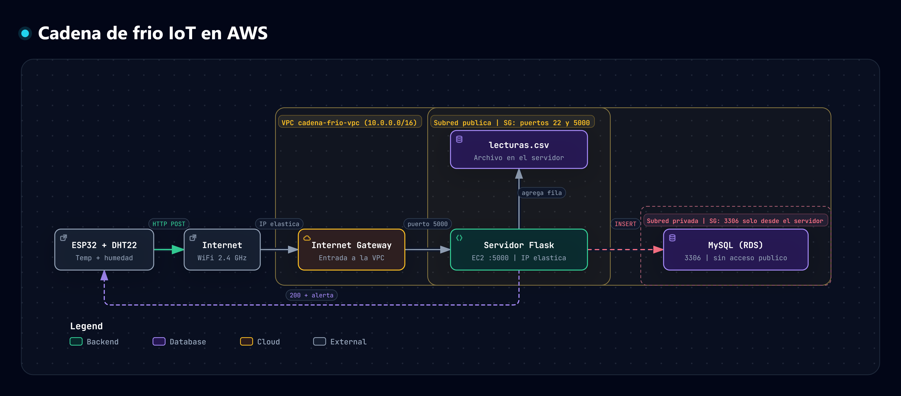

# Cadena de frío IoT

Este proyecto es la práctica 1 de Inteligencia Artificial aplicada a Internet de las Cosas. Simula una caja de transporte de vacunas y medicamentos: una ESP32 con un sensor DHT22 mide la temperatura y la humedad, las envía por WiFi a un servidor hecho en Flask, y el servidor las guarda en un archivo CSV y en una base de datos MySQL. Si la temperatura sale del rango de 2 °C a 8 °C, la lectura se marca como alerta. La humedad solo se registra, porque no tiene un límite estándar.

## Cómo ponerlo a funcionar

1. Instala Python desde python.org, marcando la casilla "Add python.exe to PATH" antes de darle a Install.
2. Instala MySQL Server y MySQL Workbench con el instalador de MySQL (instalación personalizada) y crea la contraseña del usuario root.
3. Descarga este proyecto con el botón verde "Code" y luego "Download ZIP", y descomprímelo.
4. Abre la carpeta en una terminal y crea el entorno virtual con `python -m venv venv`.
5. Actívalo con `.\venv\Scripts\Activate.ps1`.
6. Instala las librerías con `pip install -r requirements.txt`.
7. En Workbench entra a la instancia local, abre el archivo `crear_tabla.sql` con File > Open SQL Script y ejecútalo con el rayo amarillo.
8. Copia `config.example.py`, ponle el nombre `config.py` y cambia la contraseña por la tuya.
9. Corre el servidor con `python app.py`.
10. En otra terminal, manda una lectura de prueba con `Invoke-RestMethod -Uri http://127.0.0.1:5000/datos -Method Post -ContentType "application/json" -Body '{"temperatura": 5.2, "humedad": 48}'` y revisa que aparezca en `lecturas.csv` y en Workbench con `SELECT * FROM cadena_frio.lecturas;`.

## La parte de la ESP32

El código de la ESP32 está en la carpeta `esp32`. Lee la temperatura y la humedad con un sensor DHT22 y las envía cada 5 segundos al servidor por WiFi.

1. Instala Arduino IDE. En Archivo > Preferencias, en "Gestor de URLs Adicionales de Tarjetas", pega `https://espressif.github.io/arduino-esp32/package_esp32_index.json`.
2. En Herramientas > Placa > Gestor de tarjetas, busca `esp32` e instala "esp32 by Espressif Systems". Si falla por tiempo agotado, cierra el programa, ábrelo y reintenta.
3. En Herramientas > Administrar bibliotecas, busca `DHT sensor library` e instala la de Adafruit, aceptando las dependencias.
4. Con la ESP32 desconectada, conecta el DHT22 de 3 pines: VCC al pin 3V3, GND a un pin GND y DATA al pin D4 (GPIO 4). Revisa los rótulos del módulo porque el orden cambia según el fabricante.
5. Abre `esp32/cadena_frio_esp32.ino` en Arduino IDE y cambia el nombre y la clave de tu WiFi, que debe ser de 2,4 GHz.
6. Corre `ipconfig` en tu computador, copia la Dirección IPv4 del adaptador Wi-Fi y ponla en la línea `servidor`, en lugar de `IP_DE_TU_COMPUTADOR`.
7. Elige la placa ESP32 Dev Module y el puerto COM, y dale Subir. Si se queda en "Connecting...", mantén presionado el botón BOOT de la ESP32.
8. Con `python app.py` corriendo, abre el Monitor Serie a 115200 baudios. Debe salir la temperatura, la humedad y "Respuesta del servidor: 200" en cada lectura.
9. Si sale `-1` en lugar de 200, revisa la IP, que el servidor esté corriendo y que el firewall de Windows permita el puerto 5000 en redes privadas.

## La parte en la nube (AWS)

El diagrama se generó con Archify. Su fuente está en `docs/iot.architecture.json` y la versión interactiva en `docs/iot.html`.

La segunda parte de la práctica se montó en AWS Academy, en la región us-east-1 (Norte de Virginia). Se creó una VPC llamada cadena-frio-vpc con una subred pública y dos subredes privadas. En la subred pública corre una máquina virtual EC2 con Ubuntu, que ejecuta el servidor Flask y tiene asignada una IP elástica, para que su dirección no cambie cuando el laboratorio se apaga y se enciende. En las subredes privadas está la base de datos MySQL, creada con el servicio RDS, sin acceso público: solo el servidor puede conectarse a ella.

Los grupos de seguridad controlan quién puede entrar. El grupo del servidor permite el puerto 5000 (para que la ESP32 envíe los datos) y el puerto 22 (para administrar la máquina). La base de datos solo acepta tráfico que venga del servidor, por el puerto 3306.

Para replicarlo, estos son los pasos:

1. Crear la VPC con el asistente "VPC y más", con una subred pública y una privada, sin puerta de enlace NAT. Agregar una segunda subred privada en otra zona de disponibilidad, porque RDS lo exige.
2. Lanzar una instancia EC2 con Ubuntu en la subred pública, con la clave vockey, y un grupo de seguridad que permita los puertos 22 y 5000.
3. Asignar una dirección IP elástica y asociarla a la instancia.
4. Crear la base de datos en RDS con el motor MySQL, en la capa gratuita, dentro de la VPC, con acceso público desactivado y conectada a la instancia EC2. Poner `cadena_frio` como nombre de la base inicial.
5. Conectarse a la instancia, instalar python3-venv, pip, git y mysql-client, y clonar este repositorio.
6. Crear el entorno virtual, instalar las librerías con `pip install -r requirements.txt` y copiar `config.example.py` como `config.py`, poniendo el punto de enlace de RDS, el usuario admin y su contraseña.
7. Entrar a la base con el cliente mysql y crear la tabla con el contenido de `crear_tabla.sql`.
8. Arrancar el servidor en segundo plano con `nohup python app.py > flask.log 2>&1 &`.
9. En el código de la ESP32, cambiar la línea del servidor por `http://IP_ELASTICA:5000/datos`, poniendo la IP elástica de su propia instancia.

Las horas guardadas en la base de datos y en el CSV están en UTC, que son cinco horas más que la hora de Colombia.

