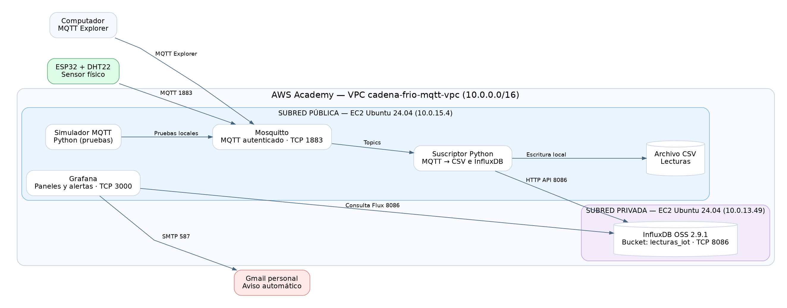

# Actividad 2 — Broker MQTT, InfluxDB y Grafana para cadena de frío IoT

Especialización en Inteligencia Artificial · Inteligencia Artificial aplicada a Internet de las Cosas · 2026-2

## Objetivo y caso de uso

Se implementó un sistema IoT de seguimiento de temperatura y humedad para el transporte y almacenamiento de medicamentos o vacunas. La **temperatura objetivo** se definió entre **2 °C y 8 °C**: toda lectura inferior a 2 °C o superior a 8 °C genera un evento de alerta. La humedad se registra como variable de contexto, sin umbral de disparo.

La práctica extiende la **Actividad 1**, que utilizaba HTTP/Flask y MySQL, a una arquitectura con **MQTT, base de datos de series de tiempo InfluxDB y paneles Grafana**. Los archivos originales de la Actividad 1 permanecen sin cambios fuera de esta carpeta.

## Arquitectura en AWS



Ver también [diagrama editable en Mermaid](docs/arquitectura.mmd).

Se utilizó AWS Academy, región `us-east-1`, en una VPC `cadena-frio-mqtt-vpc` con una subred pública y una subred privada.

- **EC2 pública (Ubuntu 24.04):** broker Mosquitto en TCP `1883` con autenticación MQTT; programas Python para simular, suscribirse y guardar datos; Grafana en puerto `3000` (acceso administrativo mediante SSH). IP privada del servidor: `10.0.15.4`.
- **EC2 privada (Ubuntu 24.04):** InfluxDB OSS 2.9.1, puerto `8086`, IP privada `10.0.13.49`, **sin IP pública**. El grupo de seguridad solo permite el acceso al puerto 8086 desde el grupo de seguridad de la EC2 pública.
- **Dispositivo:** ESP32 con DHT22, enviando lecturas aproximadamente cada 5 s a Mosquitto. Un simulador Python independiente permite probar el flujo sin el dispositivo físico.
- **Visualización y alertas:** Grafana consulta el bucket `lecturas_iot` de InfluxDB por su IP privada y notifica mediante correo SMTP cuando detecta valores fuera de rango.

La IP pública asignada a la EC2 puede cambiar al reiniciar el laboratorio AWS Academy; no se almacena como credencial o parámetro fijo dentro del repositorio.

## Datos y tópicos

| Topic MQTT | Dato | Ejemplo |
| --- | --- | --- |
| `invernadero1/temperatura` | Temperatura, °C | `9.5` |
| `invernadero1/humedad` | Humedad, % | `65.0` |
| `invernadero1/alerta` | Estado | `NORMAL` o `ALERTA` |

El programa `aws/registro_mqtt_influx.py` registra lecturas en un archivo CSV y en el bucket `lecturas_iot` de la organización `cadena_frio`. La medición de InfluxDB se denomina `cadena_frio`, con campos `temperatura`, `humedad`, `alerta` (binario) y `estado`, y la etiqueta `origen`.

Los CSV de ejecución contienen datos de prueba y no se versionan. Las capturas de prueba están descritas en [docs/evidencias](docs/evidencias/README.md).

## Código fuente

| Archivo o directorio | Descripción |
| --- | --- |
| `esp32_mqtt/esp32_mqtt.ino` | Lectura DHT22 y publicación MQTT desde ESP32. Se debe copiar la versión final validada. |
| `aws/simulador_mqtt.py` | Publicación de lecturas simuladas en los tres tópicos MQTT. Se debe copiar desde EC2. |
| `aws/registro_csv.py` | Registro de lecturas MQTT en CSV. Se debe copiar desde EC2. |
| `aws/registro_mqtt_influx.py` | Ingesta MQTT → CSV + InfluxDB. Se debe copiar desde EC2. |
| `aws/requirements.txt` | Bibliotecas Python necesarias. |
| `mosquitto/cadena-frio.example.conf` | Ejemplo de configuración de Mosquitto sin credenciales. |
| `grafana/README.md` | Descripción del dashboard y de las alertas. |
| `docs/consultas_grafana.md` | Consultas Flux de los paneles y la regla de alerta. |

## Ejecución en la EC2 pública

Con el broker Mosquitto activo y InfluxDB disponible en la subred privada:

```bash
python3 -m venv ~/cadena-frio-venv
source ~/cadena-frio-venv/bin/activate
pip install -r actividad2/aws/requirements.txt
```

En dos terminales independientes:

```bash
python actividad2/aws/registro_mqtt_influx.py
```

```bash
python actividad2/aws/simulador_mqtt.py
```

Los scripts solicitan las credenciales necesarias de forma interactiva; no se incluyen en el repositorio. Los nombres y rutas son relativos a la carpeta raíz del repositorio clonado en la EC2.

Para acceso local al panel sin abrir el puerto 3000 a internet, establecer un túnel SSH desde el PC hacia el puerto `127.0.0.1:3000` de la EC2 pública.

## Visualización y comprobaciones

En Grafana se construyó el dashboard **Monitoreo de Cadena de Frío IoT**, con una gráfica de temperatura, otra de humedad y un indicador NORMAL (verde) / ALERTA (rojo). La regla **Alerta de temperatura fuera de rango** evalúa cada minuto la presencia de eventos `alerta = 1` en los últimos 60 segundos, y utiliza un contacto de correo electrónico SMTP. En las pruebas se recibió un aviso automático con asunto `[FIRING:1]`.

La comunicación también fue verificada con MQTT Explorer y con un ESP32 real conectado al sensor DHT22.

## Seguridad

Este repositorio es público. **No subir** `secrets.h`, archivos `.pem`, usuarios y contraseñas, tokens API, credenciales SMTP ni copias de `/etc/grafana/grafana.ini` o `/etc/mosquitto/passwd`. El archivo `.gitignore` de esta carpeta contiene exclusiones para datos y secretos.

**Nota:** Los parámetros de red y puertos muestran la topología de laboratorio, pero no representan una configuración endurecida para producción. MQTT se probó en TCP 1883 sin TLS; en un despliegue real se recomienda TLS, restricciones de acceso y gestión segura de secretos.
